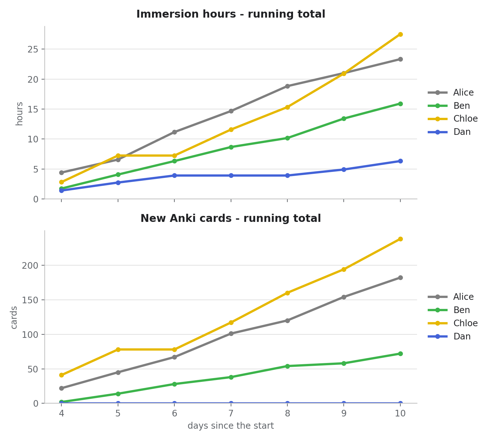
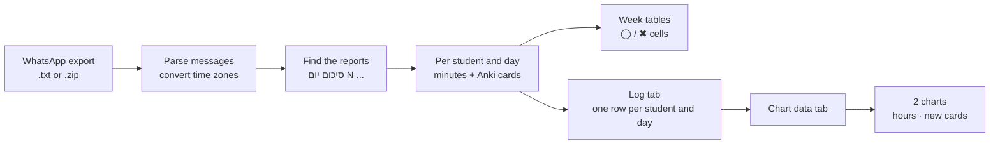

<div align="center">

# 📊 Immersion Tracker

**Turn a WhatsApp group's daily language-immersion reports into a Google Sheet, with progress charts.**


</div>

A group of learners posts a short summary every evening. This tool reads the chat export, understands the
reports (even *"שעה וחצי"* and *"1 שעה ו-20 דקות"*), and keeps a shared spreadsheet up to date:

- ◯ **circles** for every day someone put in the time, a red ✖ once a day is over with nothing reported
- 📒 a **log tab** with the full breakdown per student and day: watching, reading, listening, reels, Anki cards
- 🔤 an optional **conjugations tab**: one ◯ per 20 exercises, a ✖ below that
- 📈 **two live charts**: hours of immersion and new Anki cards, one line per student
- 🧠 it **follows your sheet**: students are listed in the order of your sheet's columns, and it never overwrites what is already in the sheet (the week-table cells, the log rows, the chart data), so your manual corrections stay

<p align="center">
  <br>
  <sub>The two charts, rendered locally from the demo data. Google Sheets draws its own version in your log tab.</sub>
</p>

## Try it in 30 seconds (no Google account needed)

```bash
git clone https://github.com/<you>/immersion-tracker.git && cd immersion-tracker
pip install -r requirements.txt

python main.py examples/sample_chat.txt \
  --config examples/demo.toml --people examples/demo_people.json \
  --offline --today "2026-11-01 12:00" --raw-hebrew --no-pause
```

```text
Parsed 28 messages (date order: MDY)
Chat times are in Asia/Jerusalem; converted to Asia/Jerusalem (latest message: 0 h earlier) - days end at 05:00 Asia/Jerusalem
Found 25 valid reports
Leaving Day 1-3 untouched - writing from Day 4 (2026-10-25)
Now: 2026-11-01 12:00 (Asia/Jerusalem) -> current day is 2026-11-01; days end at 05:00, so ✖ is given to days before 2026-11-01

--- 2 warning(s) ---
 * 2026-10-27 20:17 (Israel 10-27 20:17) Alice: ignored a line that isn't a report line (not counted): 'אולי אוסיף עוד קצת אנקי בלילה'
 * 2026-10-28 22:05 (Israel 10-28 22:05) Dan: couldn't read the צפייה duration 'כמה שיכולתי'  [סיכום יום 7]

=== week 2 ===
תלמיד | Sun 25/10 | Mon 26/10 | Tue 27/10 | Wed 28/10 | Thu 29/10 | Fri 30/10 | Sat 31/10
------+-----------+-----------+-----------+-----------+-----------+-----------+----------
Alice | ◯◯◯◯      | ◯◯        | ◯◯◯◯      | ◯◯◯       | ◯◯◯◯      | ◯◯        | ◯◯
Ben   | ◯         | ◯◯        | ◯◯        | ◯◯        | ◯         | ◯◯◯       | ◯◯
Chloe | ◯◯        | ◯◯◯◯      | ✖         | ◯◯◯◯      | ◯◯◯       | ◯◯◯◯◯     | ◯◯◯◯◯◯
Dan   | ◯         | ◯         | ◯         | ✖         | ✖         | ◯         | ◯

=== הטיות שבוע 2 ===
תלמיד | Sun 25/10 | Mon 26/10 | Tue 27/10 | Wed 28/10 | Thu 29/10 | Fri 30/10 | Sat 31/10
------+-----------+-----------+-----------+-----------+-----------+-----------+----------
Alice | ◯◯        | ✖         | ✖         | ◯         | ◯         | ◯◯        | ✖
Ben   | ✖         | ◯         | ◯         | ✖         | ◯◯        | ✖         | ◯
Chloe | ◯◯        | ◯◯◯       | ✖         | ◯         | ◯◯◯       | ✖         | ◯◯
Dan   | ✖         | ✖         | ✖         | ✖         | ✖         | ◯◯        | ◯◯◯
```

`--offline` never contacts Google. The sample chat is fictional; its demo config uses `first_week = 2`. Warnings name the student (the name from your sheet), never a phone number. Note how Dan's unreadable line
(`צפייה כמה שיכולתי`, "as much as I could") is reported as a warning instead of being silently guessed, and
earns a ✖ for that day.

## How it works



A day does not end at midnight: it runs until `day_ends_at` (05:00 by default) the next morning, so a report
sent at 02:00 still counts for the previous day, and the ✖ only appears once the day is really over.
Chat times are converted from the exporting phone's time zone (`chat_timezone`) to yours, daylight saving
included.

### The report format

Students send a message like this. A number without a unit means minutes; missing lines count as 0.

| Line | Meaning |
|---|---|
| `סיכום יום 50` | the day number (the colon is optional) |
| `צפייה 1 שעה ו-20 דקות` | watching (`יוטיוב` lines are added to it) |
| `קריאה 30` | reading |
| `שמיעה חצי שעה` | listening (`שמיעה פסיבית` is added to it) |
| `רילז 10 דקות` | reels |
| `אנקי 20 קלפים` | *optional*: new Anki cards. Logged and charted, but not part of the time |
| `הטיות 40` | *optional*: conjugation exercises (no unit needed). Goes to its own tab, not part of the time |

Understood durations: `10 דקות`, `1 שעה`, `1.5 שעות`, `1:35`, `90`, `שעה וחצי`, `רבע שעה`, `2 שעות וחצי`...
The activity names and their aliases are configurable (see [`config.example.toml`](config.example.toml)).

Any other line in a report is ignored, but if it might have carried data (it contains a number or mentions an
activity) you get a warning that names the student, so a typo like `קריאת 20 דקות` or a comment such as
*"I'll add more Anki tonight"* can't silently cost anyone their circle. An absurd day number
(`יום 29013890321890231890231`) is ignored with a warning and the day the message was sent is used instead.

### The conjugations tab

A report may end with a line like `הטיות 40`. It is kept apart from the immersion hours, in its own tab:

| Exercises | Cell |
|---|---|
| 20-39 | ◯ |
| 40-59 | ◯◯ |
| 60-79 | ◯◯◯ ... (one more circle for every 20, rounded down) |
| less than 20, or no `הטיות` line, or no report | ✖ (once the day is over, exactly like the main tab) |

The tab (`[conjugations] worksheet`, default `הטיות`) has the same layout as the week tables and the same
student columns. Its tables are named **`הטיות שבוע 3`**, `הטיות שבוע 4`, ... and the numbering is the same as
in the main tab, so `הטיות שבוע 3` covers the same days as `week 3`. The first week that has a table there is
`first_week` (3): earlier days are never written. Like everywhere else, filled cells are left alone unless you
pass `--overwrite`. Nothing is written until at least one report in the chat contains a `הטיות` line, and a
sheet without that tab simply skips it with a note. Switch it off with `[conjugations] enabled = false`.

## Quick start

**Requirements:** Python 3.9+ and a Google account.

```bash
pip install -r requirements.txt       # gspread, tzdata (and tomli on Python < 3.11)

# 1. Google access: one-time, ~5 minutes -> docs/google-setup.md
#    gives you credentials/service_account.json and your spreadsheet id

# 2. Your local (git-ignored) files
cp .env.example .env                  # put your SPREADSHEET_ID in it
cp config.example.toml config.toml    # dates, time zones, tab names...

# 3. Tell the tool who is who (interactive, progress is saved after every answer)
python main.py chat.txt --setup

# 4. Look, then write
python main.py chat.txt --dry-run     # reads the sheet, writes nothing
python main.py chat.txt               # updates the sheet
```

`chat.txt` is a WhatsApp *Export chat -> Without media* file (the `.zip` it produces works too).
Re-run it whenever you export a fresh chat. It is safe to run as often as you like: each run only
adds or refreshes rows, and cells that already hold ◯ / ✖ are left alone.

## Usage

```text
python main.py <chat export> [options]
# same thing:  python -m immersion_tracker ...      (or  immersion-tracker ...  after  pip install -e .)
```

| Option | What it does |
|---|---|
| `--setup` / `--all` | classify people in the chat as student (+ sheet column) or ignored; `--all` revisits everyone |
| `--list-senders` | list everyone who posted and whether they are classified |
| `--dry-run` | print the plan (and read the sheet for its column order), write nothing |
| `--offline` | don't contact Google at all; implies `--dry-run` |
| `--day1 DATE` | date of Day #1 (`YYYY-MM-DD`), overrides `day_1_date` |
| `--skip-first N` / `--skip-until-week N` | leave the first N days / everything before week N untouched |
| `--today WHEN` | pretend it is now: `2026-10-30` (noon) or `"2026-10-30 04:30"` |
| `--cutoff HOUR` | hour the day ends, e.g. `5` or `04:30`, overrides `day_ends_at` |
| `--date-order {auto,DMY,MDY,YMD}` | how dates in the export are written (default: guess) |
| `--overwrite` | replace what is already in the sheet with the chat's version: ◯ / ✖ cells, log rows and chart data |
| `--rebuild-charts` | rebuild only the chart data tab from the log, leaving the log (and your corrections in it) as it is |
| `--raw-hebrew` | plain logical-order Hebrew (for terminals that already handle it) |
| `--no-pause` | don't wait for Enter at the end |
| `--config FILE` / `--people FILE` | use other settings / people files than `config.toml` / `people.json` |

## Configuration

Secrets, settings and personal data each live in their own file. All of these are **git-ignored**; the
committed `*.example.*` files show the format.

| File | Holds | Created from |
|---|---|---|
| `.env` | `SPREADSHEET_ID`, where the Google key is | [`.env.example`](.env.example) |
| `credentials/service_account.json` | the Google service-account key | [`credentials/service_account.example.json`](credentials/service_account.example.json) |
| `config.toml` | calendar, report format, tab names, look, charts | [`config.example.toml`](config.example.toml) |
| `people.json` | WhatsApp name -> sheet column (names / phone numbers!) | written by `--setup`, see [`people.example.json`](people.example.json) |

### Environment variables (`.env`)

| Variable | |
|---|---|
| `SPREADSHEET_ID` | **required**: the id in the sheet's URL |
| `GOOGLE_SERVICE_ACCOUNT_FILE` | path to the key file (default `credentials/service_account.json`) |
| `GOOGLE_SERVICE_ACCOUNT_JSON` | the key's JSON on one line, for servers / CI (wins over the file) |
| `IMMERSION_TRACKER_HOME` | keep `.env`, `config.toml`, `people.json` and `credentials/` in another folder |

Real environment variables always win over `.env`.

### Settings (`config.toml`)

Every key is optional; unknown keys are rejected so a typo can't silently do nothing.

| Section | Controls |
|---|---|
| `[calendar]` | week start, Day #1 (weekday and date), which early days to skip, time zones, when a day ends, `format_start` |
| `[reports]` | activities and their aliases, Anki words, circle rounding, what to do with several reports for one day |
| `[sheet]` | tab names, how week tables are found, weekday labels |
| `[appearance]` | circle / cross characters, colours, whether filled cells may be overwritten |
| `[charts]` | on/off, running total vs per day, size and position |
| `[conjugations]` | the `הטיות` line: its words, the tab and table names, first week, exercises per circle |
| `[console]` | Hebrew display fix for terminals, "press Enter" pause |

<details>
<summary><b>What the charts show</b></summary>

- **Top:** hours of immersion; **bottom:** new Anki cards. Both are running totals by default
  (`hours_cumulative` / `cards_cumulative` switch each to per-day values).
- X axis: days since the start. A finished day with no report counts as 0.
- One line per student, in the order of the sheet's columns. A student's colour is derived from their name,
  so it never changes between runs, and no two students share one (12 colours, all clearly distinct).
- Both charts are anchored in the same column with the same width, stacked one above the other, right next
  to the log table. They are replaced on every run.
- They read from a helper tab (a Sheets chart can't pivot the long log format by itself). That tab is
  **add-only**, like the circles: a filled cell is never replaced, only empty cells are filled (new days, new
  students). Days and students already in it stay even if they leave the log or `people.json`.
- Running totals **continue from what the tab holds**: if you correct a student's total by hand, the next
  days build on your corrected number instead of jumping back to the log's own total.
- To refresh one cell, clear it. To rebuild the whole tab from the log, run with `--rebuild-charts`.
  Switching `hours_cumulative` / `cards_cumulative` rebuilds just that block, so running totals and per-day
  values are never mixed.

</details>

## Project layout

```text
immersion-tracker/
├── main.py                      # python main.py ...  (thin wrapper)
├── immersion_tracker/
│   ├── cli.py                   # arguments and the overall flow
│   ├── settings.py              # typed settings: defaults + config.toml, validated
│   ├── credentials.py           # .env loading, Google credentials
│   ├── paths.py                 # where the local files live
│   ├── timeline.py              # days, week-table rows, time zones
│   ├── whatsapp.py              # reading the chat export
│   ├── durations.py             # "1 שעה ו-20 דקות" -> 80, Anki card counts
│   ├── reports.py               # finding a report in a message
│   ├── planning.py              # reports -> which cell gets what
│   ├── people.py                # people.json, column order
│   ├── setup_wizard.py          # interactive --setup
│   ├── console.py               # tables, Hebrew terminal fix
│   └── sheets/
│       ├── client.py            # connecting
│       ├── week_tables.py       # finding and filling the week tables
│       ├── log.py               # the log tab
│       ├── charts.py            # chart data tab + chart requests
│       ├── palette.py           # a stable colour per student
│       └── colors.py
├── tests/                       # unit tests + end-to-end tests on a fake Google Sheet
├── examples/                    # fictional chat + demo config for the offline demo
├── docs/                        # Google setup guide, chart preview
├── config.example.toml  .env.example  people.example.json  credentials/
└── .github/workflows/ci.yml     # tests on Python 3.9 - 3.12
```

## Development

```bash
python -m unittest discover -s tests -v       # or:  pytest
```

The tests need no Google account and no secrets: an in-memory stand-in for `gspread`
([`tests/fake_gspread.py`](tests/fake_gspread.py)) lets the end-to-end tests run the real command line.

## Where is my data stored?

Nothing is kept in a local database: **the Google Sheet is the memory.** The tool reads the chat export, adds
what is new, and leaves the rest alone.

| Where | What | Fixing a mistake |
|---|---|---|
| Sheet, week tab | the ◯ / ✖ cells | edit the cell (it is never overwritten) |
| Sheet, conjugations tab | the ◯ / ✖ cells for the `הטיות` line | edit the cell (it is never overwritten) |
| Sheet, **log tab** | one row per student and day: the source of truth for the charts | edit the row (it is never overwritten) |
| Sheet, chart data tab | the numbers behind the two charts | edit or clear a cell; `--rebuild-charts` rebuilds the tab from the log |
| `people.json` (project folder) | who is who: WhatsApp name -> sheet column | `--setup`, or edit the file |
| `.env`, `config.toml`, `credentials/` | secrets and settings | edit the files |
| your chat export | wherever you saved it; read on every run, never copied | - |

**Correcting a wrong report** (say someone typed 400 Anki cards instead of 40): fix that row in the log tab
(or the cell in the week table). It stays fixed on every later run, even though the chat still says 400. Then
run with `--rebuild-charts` so the charts pick the corrected log up. Use `--overwrite` only when you want the
sheet reset to what the chat says. Use *Version history* in Google Sheets if you want to go back in time.

## Security and privacy

- `.env`, `credentials/*`, `config.toml`, `people.json` and chat exports are in [`.gitignore`](.gitignore).
  Check with `git status` before your first commit; if a key ever lands in a commit, treat it as leaked:
  delete it in the Google Cloud console and create a new one.
- The service account can only touch spreadsheets you explicitly share with it.
- A chat export contains other people's messages and phone numbers: keep it out of the repository.

## Troubleshooting

| Symptom | Fix |
|---|---|
| `SPREADSHEET_ID is not set` / `Service-account key not found` | step 2 of the quick start; see [`docs/google-setup.md`](docs/google-setup.md) |
| `APIError 403` / `The caller does not have permission` | share the sheet with the key's `client_email` as **Editor** |
| `Google Sheets API has not been used in project...` | enable the **Google Sheets API** in your Google Cloud project |
| `No week tables found` | tables must be named `week 1`, `week 2`... or have the `曜日` header over the weekday labels; check `[sheet]` and `week_starts_on` |
| `No time zone data for 'Asia/...'` | `pip install tzdata` (Windows has no time-zone database) |
| Hebrew shows up reversed | leave `bidi_fix = true`; if your terminal already handles Hebrew, use `--raw-hebrew` |
| Day numbers are off by one | pin `day_1_date` in `config.toml` (or pass `--day1`) |
| Wrong dates when parsing the chat | pass `--date-order DMY` / `MDY` / `YMD` |

## License

[MIT](LICENSE)
