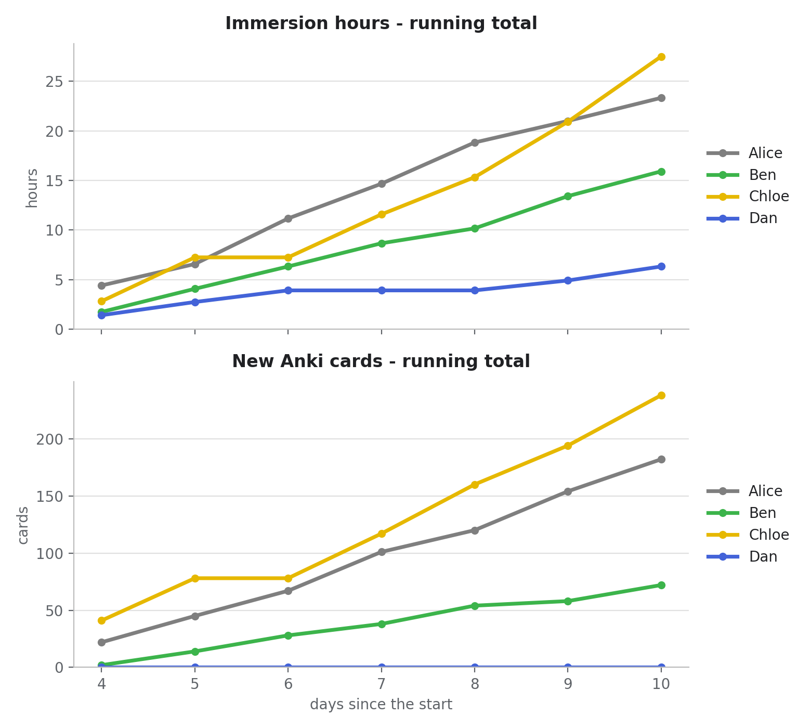
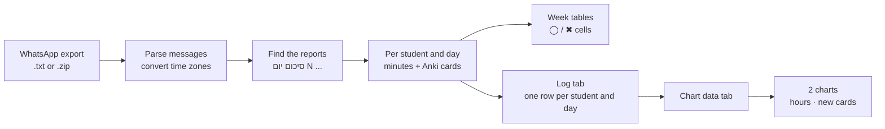

<div align="center">

# 📊 Immersion Tracker

**Turn a WhatsApp group's daily language-immersion reports into a Google Sheet, with progress charts.**


</div>

A group of learners posts a short summary every evening. This tool reads the chat export, understands the
reports (even *"שעה וחצי"* and *"1 שעה ו-20 דקות"*), and keeps a shared spreadsheet up to date:

- ◯ **circles** for every day someone put in the time, a red ✖ once a day is over with nothing reported
- 📒 a **log tab** with the full breakdown per student and day: watching, reading, listening, reels, Anki cards
- 📈 **two live charts**: hours of immersion and new Anki cards, one line per student
- 🧠 it **follows your sheet**: students are listed in the order of your sheet's columns, and it never overwrites cells that are already filled in

<p align="center">
  <br>
  <sub>The two charts, rendered locally from the demo data. Google Sheets draws its own version in your log tab.</sub>
</p>

## Try it in 30 seconds (no Google account needed)

```bash
git clone https://github.com/<you>/immersion-tracker.git && cd immersion-tracker
pip install -r requirements.txt

python main.py examples/sample_chat.txt \
  --config examples/demo.toml --people examples/demo_people.json \
  --offline --today "2026-11-01 12:00" --raw-hebrew --no-pause
```

```text
Parsed 28 messages (date order: MDY)
Chat times are in Asia/Jerusalem; converted to Asia/Jerusalem (latest message: 0 h earlier) - days end at 05:00 Asia/Jerusalem
Found 25 valid reports
Leaving Day 1-3 untouched - writing from Day 4 (2026-10-25)
Now: 2026-11-01 12:00 (Asia/Jerusalem) -> current day is 2026-11-01; days end at 05:00, so ✖ is given to days before 2026-11-01

--- 1 warning(s) ---
 * 2026-10-28 22:05 (Israel 10-28 22:05) Dan Peretz: couldn't read the צפייה duration 'כמה שיכולתי'  [סיכום יום 7]

=== week 2 ===
תלמיד | Sun 25/10 | Mon 26/10 | Tue 27/10 | Wed 28/10 | Thu 29/10 | Fri 30/10 | Sat 31/10
------+-----------+-----------+-----------+-----------+-----------+-----------+----------
Alice | ◯◯◯◯      | ◯◯        | ◯◯◯◯      | ◯◯◯       | ◯◯◯◯      | ◯◯        | ◯◯
Ben   | ◯         | ◯◯        | ◯◯        | ◯◯        | ◯         | ◯◯◯       | ◯◯
Chloe | ◯◯        | ◯◯◯◯      | ✖         | ◯◯◯◯      | ◯◯◯       | ◯◯◯◯◯     | ◯◯◯◯◯◯
Dan   | ◯         | ◯         | ◯         | ✖         | ✖         | ◯         | ◯
```

`--offline` never contacts Google. The sample chat is fictional. Note how Dan's unreadable line
(`צפייה כמה שיכולתי`, "as much as I could") is reported as a warning instead of being silently guessed, and
earns a ✖ for that day.

## How it works



A day does not end at midnight: it runs until `day_ends_at` (05:00 by default) the next morning, so a report
sent at 02:00 still counts for the previous day, and the ✖ only appears once the day is really over.
Chat times are converted from the exporting phone's time zone (`chat_timezone`) to yours, daylight saving
included.

### The report format

Students send a message like this. A number without a unit means minutes; missing lines count as 0.

| Line | Meaning |
|---|---|
| `סיכום יום 50` | the day number (the colon is optional) |
| `צפייה 1 שעה ו-20 דקות` | watching (`יוטיוב` lines are added to it) |
| `קריאה 30` | reading |
| `שמיעה חצי שעה` | listening (`שמיעה פסיבית` is added to it) |
| `רילז 10 דקות` | reels |
| `אנקי 20 קלפים` | *optional*: new Anki cards. Logged and charted, but not part of the time |

Understood durations: `10 דקות`, `1 שעה`, `1.5 שעות`, `1:35`, `90`, `שעה וחצי`, `רבע שעה`, `2 שעות וחצי`...
The activity names and their aliases are configurable (see [`config.example.toml`](config.example.toml)).

## Quick start

**Requirements:** Python 3.9+ and a Google account.

```bash
pip install -r requirements.txt       # gspread, tzdata (and tomli on Python < 3.11)

# 1. Google access: one-time, ~5 minutes -> docs/google-setup.md
#    gives you credentials/service_account.json and your spreadsheet id

# 2. Your local (git-ignored) files
cp .env.example .env                  # put your SPREADSHEET_ID in it
cp config.example.toml config.toml    # dates, time zones, tab names...

# 3. Tell the tool who is who (interactive, progress is saved after every answer)
python main.py chat.txt --setup

# 4. Look, then write
python main.py chat.txt --dry-run     # reads the sheet, writes nothing
python main.py chat.txt               # updates the sheet
```

`chat.txt` is a WhatsApp *Export chat -> Without media* file (the `.zip` it produces works too).
Re-run it whenever you export a fresh chat. It is safe to run as often as you like: each run only
adds or refreshes rows, and cells that already hold ◯ / ✖ are left alone.

## Usage

```text
python main.py <chat export> [options]
# same thing:  python -m immersion_tracker ...      (or  immersion-tracker ...  after  pip install -e .)
```

| Option | What it does |
|---|---|
| `--setup` / `--all` | classify people in the chat as student (+ sheet column) or ignored; `--all` revisits everyone |
| `--list-senders` | list everyone who posted and whether they are classified |
| `--dry-run` | print the plan (and read the sheet for its column order), write nothing |
| `--offline` | don't contact Google at all; implies `--dry-run` |
| `--day1 DATE` | date of Day #1 (`YYYY-MM-DD`), overrides `day_1_date` |
| `--skip-first N` / `--skip-until-week N` | leave the first N days / everything before week N untouched |
| `--today WHEN` | pretend it is now: `2026-10-30` (noon) or `"2026-10-30 04:30"` |
| `--cutoff HOUR` | hour the day ends, e.g. `5` or `04:30`, overrides `day_ends_at` |
| `--date-order {auto,DMY,MDY,YMD}` | how dates in the export are written (default: guess) |
| `--overwrite` | also overwrite cells that already hold ◯ / ✖ |
| `--raw-hebrew` | plain logical-order Hebrew (for terminals that already handle it) |
| `--no-pause` | don't wait for Enter at the end |
| `--config FILE` / `--people FILE` | use other settings / people files than `config.toml` / `people.json` |

## Configuration

Secrets, settings and personal data each live in their own file. All of these are **git-ignored**; the
committed `*.example.*` files show the format.

| File | Holds | Created from |
|---|---|---|
| `.env` | `SPREADSHEET_ID`, where the Google key is | [`.env.example`](.env.example) |
| `credentials/service_account.json` | the Google service-account key | [`credentials/service_account.example.json`](credentials/service_account.example.json) |
| `config.toml` | calendar, report format, tab names, look, charts | [`config.example.toml`](config.example.toml) |
| `people.json` | WhatsApp name -> sheet column (names / phone numbers!) | written by `--setup`, see [`people.example.json`](people.example.json) |

### Environment variables (`.env`)

| Variable | |
|---|---|
| `SPREADSHEET_ID` | **required**: the id in the sheet's URL |
| `GOOGLE_SERVICE_ACCOUNT_FILE` | path to the key file (default `credentials/service_account.json`) |
| `GOOGLE_SERVICE_ACCOUNT_JSON` | the key's JSON on one line, for servers / CI (wins over the file) |
| `IMMERSION_TRACKER_HOME` | keep `.env`, `config.toml`, `people.json` and `credentials/` in another folder |

Real environment variables always win over `.env`.

### Settings (`config.toml`)

Every key is optional; unknown keys are rejected so a typo can't silently do nothing.

| Section | Controls |
|---|---|
| `[calendar]` | week start, Day #1 (weekday and date), which early days to skip, time zones, when a day ends, `format_start` |
| `[reports]` | activities and their aliases, Anki words, circle rounding, what to do with several reports for one day |
| `[sheet]` | tab names, how week tables are found, weekday labels |
| `[appearance]` | circle / cross characters, colours, whether filled cells may be overwritten |
| `[charts]` | on/off, running total vs per day, size and position |
| `[console]` | Hebrew display fix for terminals, "press Enter" pause |

<details>
<summary><b>What the charts show</b></summary>

- **Top:** hours of immersion; **bottom:** new Anki cards. Both are running totals by default
  (`hours_cumulative` / `cards_cumulative` switch each to per-day values).
- X axis: days since the start. A finished day with no report counts as 0.
- One line per student, in the order of the sheet's columns. A student's colour is derived from their name,
  so it never changes between runs, and no two students share one (12 colours, all clearly distinct).
- Both charts are anchored in the same column with the same width, stacked one above the other, right next
  to the log table. They are replaced on every run.
- They read from a helper tab the tool rewrites on every run (a Sheets chart can't pivot the long log
  format by itself).

</details>

## Project layout

```text
immersion-tracker/
├── main.py                      # python main.py ...  (thin wrapper)
├── immersion_tracker/
│   ├── cli.py                   # arguments and the overall flow
│   ├── settings.py              # typed settings: defaults + config.toml, validated
│   ├── credentials.py           # .env loading, Google credentials
│   ├── paths.py                 # where the local files live
│   ├── timeline.py              # days, week-table rows, time zones
│   ├── whatsapp.py              # reading the chat export
│   ├── durations.py             # "1 שעה ו-20 דקות" -> 80, Anki card counts
│   ├── reports.py               # finding a report in a message
│   ├── planning.py              # reports -> which cell gets what
│   ├── people.py                # people.json, column order
│   ├── setup_wizard.py          # interactive --setup
│   ├── console.py               # tables, Hebrew terminal fix
│   └── sheets/
│       ├── client.py            # connecting
│       ├── week_tables.py       # finding and filling the week tables
│       ├── log.py               # the log tab
│       ├── charts.py            # chart data tab + chart requests
│       ├── palette.py           # a stable colour per student
│       └── colors.py
├── tests/                       # unit tests + end-to-end tests on a fake Google Sheet
├── examples/                    # fictional chat + demo config for the offline demo
├── docs/                        # Google setup guide, chart preview
├── config.example.toml  .env.example  people.example.json  credentials/
└── .github/workflows/ci.yml     # tests on Python 3.9 - 3.12
```

## Development

```bash
python -m unittest discover -s tests -v       # or:  pytest
```

The tests need no Google account and no secrets: an in-memory stand-in for `gspread`
([`tests/fake_gspread.py`](tests/fake_gspread.py)) lets the end-to-end tests run the real command line.

## Security and privacy

- `.env`, `credentials/*`, `config.toml`, `people.json` and chat exports are in [`.gitignore`](.gitignore).
  Check with `git status` before your first commit; if a key ever lands in a commit, treat it as leaked:
  delete it in the Google Cloud console and create a new one.
- The service account can only touch spreadsheets you explicitly share with it.
- A chat export contains other people's messages and phone numbers: keep it out of the repository.

## Troubleshooting

| Symptom | Fix |
|---|---|
| `SPREADSHEET_ID is not set` / `Service-account key not found` | step 2 of the quick start; see [`docs/google-setup.md`](docs/google-setup.md) |
| `APIError 403` / `The caller does not have permission` | share the sheet with the key's `client_email` as **Editor** |
| `Google Sheets API has not been used in project...` | enable the **Google Sheets API** in your Google Cloud project |
| `No week tables found` | tables must be named `week 1`, `week 2`... or have the `曜日` header over the weekday labels; check `[sheet]` and `week_starts_on` |
| `No time zone data for 'Asia/...'` | `pip install tzdata` (Windows has no time-zone database) |
| Hebrew shows up reversed | leave `bidi_fix = true`; if your terminal already handles Hebrew, use `--raw-hebrew` |
| Day numbers are off by one | pin `day_1_date` in `config.toml` (or pass `--day1`) |
| Wrong dates when parsing the chat | pass `--date-order DMY` / `MDY` / `YMD` |

## License

[MIT](LICENSE)
